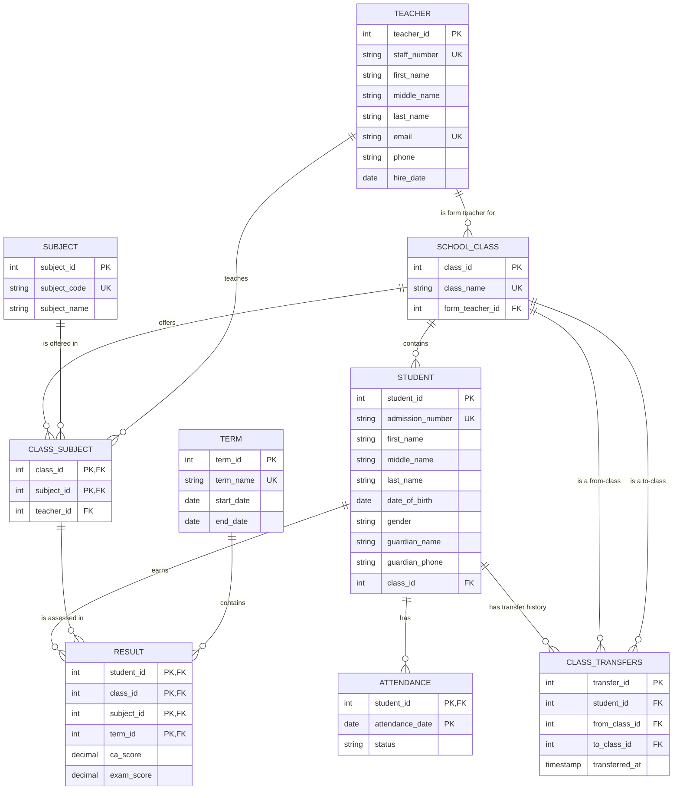

# Secondary School Database

MySQL/MariaDB relational schema for students, teachers, classes, subjects,
terms, results, attendance, and student class-transfer history.

## Requirements

- MySQL 8.0.16+ or MariaDB 10.2.1+ (enforced `CHECK` constraints).
- InnoDB and `utf8mb4` are set by the schema.
- Query 3's window-function version and query 7's CTE need MySQL 8.0+ or
  MariaDB 10.2+. Query 3 also includes an older-MySQL fallback.

## Load the database

From a terminal, create the database once, then run the schema and sample data:

```sh
mysql -u root -p -e "CREATE DATABASE swd_school CHARACTER SET utf8mb4 COLLATE utf8mb4_unicode_ci;"
mysql -u root -p swd_school < schema.sql
mysql -u root -p swd_school < seed.sql
```

The schema drops and recreates its tables. **It deletes existing data in those
tables**, so back up any data you need before rerunning it. Load `schema.sql`
before the other SQL files.

Optional follow-up:

```sh
mysql -u root -p swd_school < indexes.sql
mysql -u root -p swd_school < procedures.sql
```

`indexes.sql` shows plans before creating indexes, creates the additional
indexes, refreshes table statistics, and then shows plans again. Run it once;
the index names must not already exist. `procedures.sql` creates
`sp_record_result`, which you can call, for example, with:

```sql
CALL sp_record_result(1, 1, 1, 32.50, 48.00);
```

`transactions.sql` contains a runnable example transfer and creates
`sp_move_student_safely`. Edit the example IDs before running it: the transfer
updates a student's class and adds a permanent audit row.

## File guide

| File | Purpose |
|---|---|
| [schema.sql](./schema.sql) | Tables, keys, constraints, and drop/recreate setup. |
| [seed.sql](./seed.sql) | Fictional Nigerian sample data, including generated results and attendance. |
| [queries.sql](./queries.sql) | Eight commented reporting queries and two views. |
| [indexes.sql](./indexes.sql) | `EXPLAIN` comparisons and optional supporting indexes. |
| [transactions.sql](./transactions.sql) | Atomic class-transfer examples and checked transfer procedure. |
| [procedures.sql](./procedures.sql) | Validated result upsert procedure. |

## ER diagram



## Three useful query patterns

The complete, runnable examples are in [queries.sql](./queries.sql). Change
the sample term name there when querying a different term.

### 1. Class ranking with a window function

Query 3 calculates each student's average across subject results, then ranks
students within each class and term:

```sql
RANK() OVER (
    PARTITION BY r.class_id, r.term_id
    ORDER BY AVG(r.ca_score + r.exam_score) DESC
) AS class_position
```

`PARTITION BY` restarts ranks for each class/term. Equal averages share a rank,
and the next rank is skipped (for example, `1, 2, 2, 4`). The query also
includes a correlated-subquery fallback for older MySQL versions.

### 2. Keep teachers with no assignments

Query 6 starts from `teacher` and uses a `LEFT JOIN` to class-subject
assignments. That preserves teachers with no subjects; `COUNT(DISTINCT ...)`
then reports their subject and class counts as zero without multiplying a
class count when a teacher teaches multiple subjects in it.

### 3. Attendance percentage without dropping students

Query 7 starts from `student` and `LEFT JOIN`s attendance, so a student with no
attendance rows is included at 0%. It treats both `present` and `late` as
attended, divides by recorded days, and filters below 80%. The denominator is
the days actually recorded; for a policy based on scheduled school days,
compare against a calendar/term-day table instead.

## Understanding `EXPLAIN`

`indexes.sql` contains the exact `EXPLAIN` statements for queries 3, 5, and 7
before and after its indexes. I cannot provide measured before/after output
without running a MySQL/MariaDB server populated with this schema; optimizer
choices and `rows` estimates depend on server version, statistics, and data
volume. Run the file against your database and compare:

- **`type`** describes access: `ALL` is a table scan; `ref`/`range` typically
  indicate indexed lookup or range access. The best type depends on selectivity.
- **`key`** is the index the optimizer chose; `NULL` means no index was used.
- **`rows`** is an estimate of rows examined, not the exact count returned.

Typical plan changes to look for (these are expectations, **not measured
output**):

| Query | Before | After | What to learn from `rows` |
|---|---|---|---|
| 3 | The existing `idx_result_term` may be used, or a scan for a tiny table. | The composite result index may be selected with `ref` access and can cover the result-side fields. | Rows still need to include all results for the selected term; the index mainly helps access/grouping and avoids clustered-row lookups. |
| 5 | The existing term index may be selected, or a scan if the table is small. | The composite result index may provide a covering scan for that term. | `ca_score + exam_score < 40` is a computed predicate, so this index does not avoid reading each candidate result for the term. |
| 7 | `PRIMARY` can find attendance by student, but fetching `status` requires the table row. | `idx_attendance_student_status` can give a covering `ref` lookup (`Using index`). | The matching attendance-row estimate may be similar; the benefit is avoiding base-row reads, not reducing qualifying rows. |

With the small seed dataset, the optimizer may still choose `ALL`, or keep an
existing index, because scanning a few rows is cheap. An unchanged plan does
not by itself mean an index is broken. Use realistic data and
`EXPLAIN ANALYZE` (where supported) to assess actual execution.

## Export the full database from phpMyAdmin

1. Open phpMyAdmin and select the **`swd_school` database** in the left sidebar,
   not an individual table.
2. Choose **Export**.
3. Select **Custom** if you need to verify options (or **Quick** for defaults),
   and choose **SQL** as the format.
4. Ensure all tables are selected and both **structure** and **data** are
   included. Keep `CREATE TABLE` statements enabled; include views and routines
   if you want them in the backup and your phpMyAdmin version offers those
   options.
5. Click **Export** / **Go** and save the downloaded file as `database.sql`.

The export contains the selected database's schema and data. Store the file
securely because it can contain personal student and guardian information.
